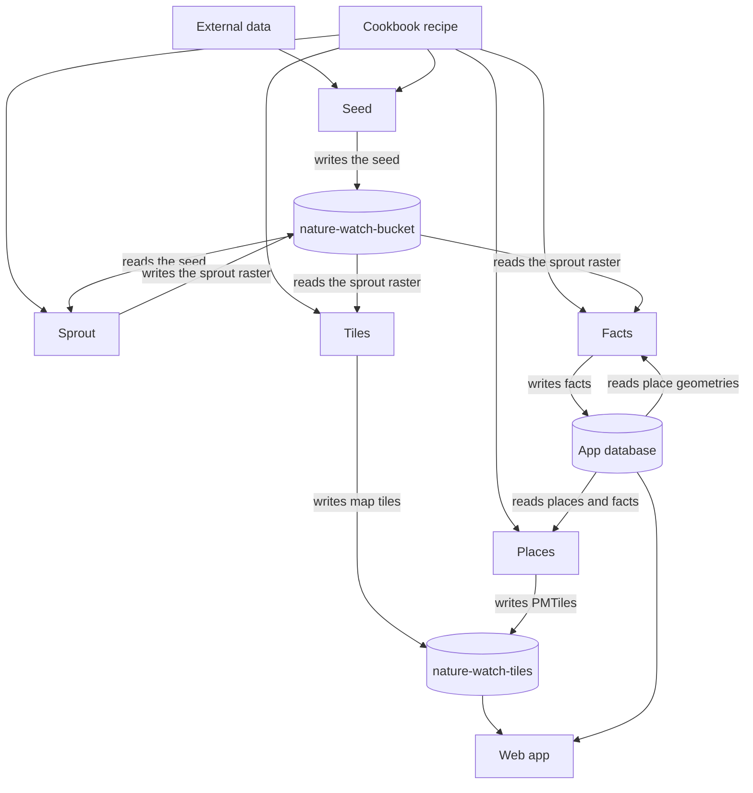
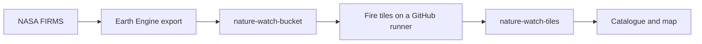

# Pipelines

> 💡 How a dataset becomes published objects

This repository publishes data. The web app, `naturewatch-app`, reads the published objects.

## Where a document lives

The same table belongs in the app blueprint.

| Subject                                                                         | Source of truth                                                                                                                                                                       |
| ------------------------------------------------------------------------------- | ------------------------------------------------------------------------------------------------------------------------------------------------------------------------------------- |
| How to read the published map                                                   | [naturewatch-app](https://github.com/marynvdl/naturewatch-app/blob/develop/docs/using-the-map.md) `docs/using-the-map.md`                                                             |
| What each map layer shows, and its limits                                       | [naturewatch-app](https://github.com/marynvdl/naturewatch-app/blob/develop/docs/data.md) `docs/data.md`                                                                               |
| The running system and the published contract: buckets, object paths, catalogue | [naturewatch-app](https://github.com/marynvdl/naturewatch-app/blob/develop/docs/blueprint.md) `docs/blueprint.md`                                                                     |
| Dated inspection notes                                                          | [naturewatch-app](https://github.com/marynvdl/naturewatch-app/blob/develop/docs/blueprint-notes.md) `docs/blueprint-notes.md`                                                         |
| The first Sooty Earth release plan                                              | [naturewatch-app](https://github.com/marynvdl/naturewatch-app/blob/develop/docs/sooty-earth-roadmap.md) `docs/sooty-earth-roadmap.md`                                                 |
| How a dataset becomes published objects                                         | This file                                                                                                                                                                             |
| The hand-edited layer catalog                                                   | [`cookbook/recipes/`](../cookbook/recipes/)                                                                                                                                           |
| How to run a step, and what that run cost                                       | The step README: [`cookbook/README.md`](../cookbook/README.md), [`seed/README.md`](../seed/README.md), [`sprout/README.md`](../sprout/README.md), [`gee/README.md`](../gee/README.md), [`places/README.md`](../places/README.md) |

## Data path

The web app and the database belong to `naturewatch-app`. The arrows into them are the handoff. How the browser reaches those stores is documented there.

There is no pipeline orchestrator in this release. Each job is started by hand. A later global year can add one, as its own decision.

## Pieces

| Piece       | What it does                                                                                                                                                                                              | Now                                                                                                                                                  |
| ----------- | --------------------------------------------------------------------------------------------------------------------------------------------------------------------------------------------------------- | ---------------------------------------------------------------------------------------------------------------------------------------------------- |
| Cookbook    | The only catalog edited by hand. A YAML recipe names a raster year or a places archive.                                                                                                                   | `cookbook/recipes/cropland-2024.yaml` is the South Africa GLAD cropland 2024 run. `cookbook/recipes/cropland-2024-v2.yaml` names 223 global tiles and the version 2 paths. Those tiles are transferred. `cookbook/recipes/places-protected-areas.yaml` is the protected-area archive. |
| Seed        | Brings in the publisher’s files, checks them against the recipe, and writes a clip under the seed path.                                                                                                   | The six South Africa tiles and the mainland clip are in `gs://nature-watch-bucket/seeds/cropland/glad/2024/v1/`. The global transfer stored 223 tiles, 5,289,882,209 bytes, under `seeds/cropland/glad/2024/v2/`, still on the host path. Check job `seed-cropland-glad-2024-v2` moves a tile that passes to the flat file name. The run record is [`seed/README.md`](../seed/README.md). |
| Data store  | Private bucket `nature-watch-bucket`, project `nature-watch-387210`, region EU. Sprout rasters and the static STAC files for that version live here.                                                       | Public access prevention is on. Fire COGs stay at `COGS/fire/<year>/`.                                                                               |
| Sprout      | Writes one versioned raster later steps read. Class values, nodata, and CRS are in the file. Static STAC files are generated from the recipe into the same version folder. They are not a second catalog. | `gs://nature-watch-bucket/sprouts/cropland/2024/v1/cropland-2024-zaf.tif` and the STAC files beside it. Written by a hand-started Batch job in `europe-west1`. Version 2 is not written. The single global COG job failed twice, on a dataset pool limit and then on the 12 hour limit, and was cancelled. The next run is per tile. The run record is [`sprout/README.md`](../sprout/README.md). |
| Facts       | Counts the sprout raster inside each place and writes square kilometres, percent, and valid coverage to the app database. The formula is `area-weighted-spheroid-v1`.                                    | 941 rows for sprout `cropland-2024-v1` are in the hosted `facts` table. The run record is `facts/README.md`. |
| Tiles       | Builds map tiles from the sprout raster and writes them to public `nature-watch-tiles`. Colour is applied in the client.                                                                                  | Cropland zooms 0–12 are at `gs://nature-watch-tiles/cropland/2024/v1/`. Written by Batch job `tiles-cropland-2024-v1`. The run record is [`tiles/README.md`](../tiles/README.md). Fire stays on `tasks/fireTiles`. The version 2 raster PMTiles sample exists locally under `max`, `q3`, `q2`, and `nearest`. Local, no cloud cost. Resampling on the global recipe is unset until one is approved. |
| Places      | Reads place geometries and copied facts from the app database and writes one PMTiles archive to public `nature-watch-tiles`. Colour is applied in the client. Later place types can add another recipe.     | Protected areas are `gs://nature-watch-tiles/places/protected-areas/v1/places.pmtiles`. The run record is [`places/README.md`](../places/README.md). |
| Tiles store | Public bucket `nature-watch-tiles`.                                                                                                                                                                       | Cropland version 1 is `cropland/<year>/v<n>/{z}/{x}/{y}.png`. Version 2 is named as `cropland/2024/v2/cropland.pmtiles` and is not written. A local sample of it, built four ways (`max`, `q3`, `q2`, `nearest`), is recorded in [`tiles/README.md`](../tiles/README.md). Fire tiles are `fire/<year>/{z}/{x}/{y}.png`. Places archives are `places/<type>/v<n>/places.pmtiles`. The 2015 and 2019 crop tiles stay at `crop/`. |

The crop, built, and bare virtual-machine tasks are retired. Their folders and workflow files are in `archive/vm-tile-tasks/`. Those workflows are not in `.github/workflows/`, and they do not start a machine. The dams Mapbox recipe is in `archive/mapbox-dams/`. The map still reads the existing tileset.

## Direction for the sprout step

Decided on 30 October 2026, not built. A later year writes one Sprout COG per geographic tile, with full-resolution classes only and no maximum or `q3` overviews. The Tiles step owns resampling, and Facts and Tiles read the collection of tiles, for example through a VRT. Each tile is resumable. Compression is benchmarked first. The reasons and open questions are in [`sprout/README.md`](../sprout/README.md). The version 2 global COG is written as one file this year.

## Fetch

The South Africa seed was fetched on a laptop. `seed/cropland.py` downloaded the GLAD tiles in small ranges, because that server closes long connections, checked them, cut the clip, and uploaded the result.

A later global year fetches with a Storage Transfer Service job in project `nature-watch-387210`. The job is started by hand and is not on a schedule. Its source is a URL list built from the recipe. Its destination is that recipe’s seed path. Google writes the objects into the bucket. The laptop is not on the path.

The transfer does not check pixels. Storage Transfer writes each object as the source host plus the URL path, under the recipe seed path. The GDAL job next to the bucket then checks the grid and the class values and leaves that path in place. A listed tile that fails stops that job. The 2024 check job `seed-cropland-glad-2024-v2` still moves each tile that passes to the file name. The global recipe has no clip. The South Africa clip was written on the laptop. Both jobs are started by hand.

## Fire, as it runs today

`gee/fire/export_fire.py` writes one COG per Africa block to `gs://nature-watch-bucket/COGS/fire/<year>/`. The tile workflow reads those COGs and writes `gs://nature-watch-tiles/fire/<year>/`. Adding the year to the map is a change in the app catalogue.

## Keeping this page current

Change the diagram when the path changes. Change the status table when a step starts or finishes. Leave the cost of a run in that step’s README. When a new object is one the app or the facts step will read, also update `docs/blueprint.md` in `naturewatch-app` in that same piece of work.
