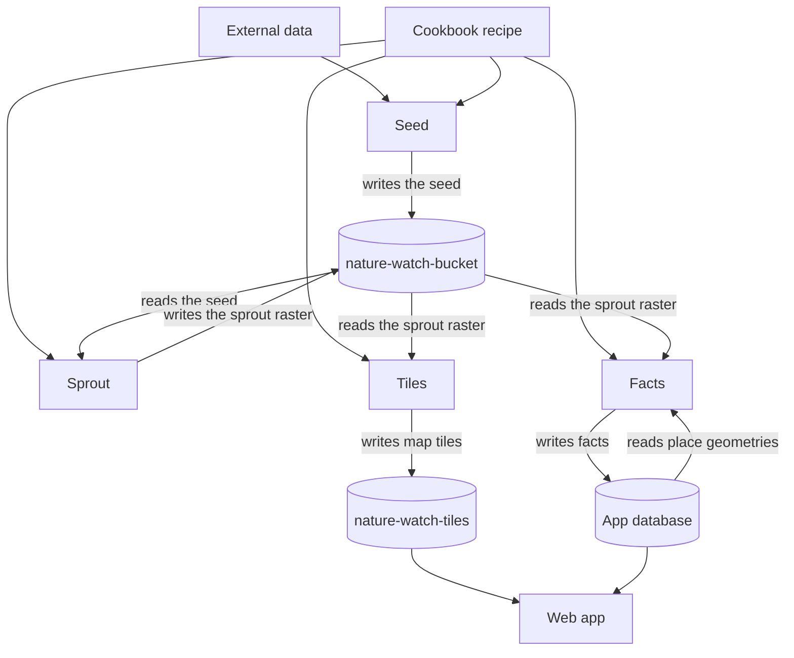
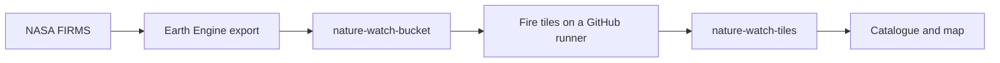

# Pipelines

> 💡 How a dataset becomes published objects

This repository publishes data. The web app, `naturewatch-app`, reads the published objects.

## Where a document lives

The same table belongs in the app blueprint.

| Subject                                                                         | Source of truth                                                                                                                                                                       |
| ------------------------------------------------------------------------------- | ------------------------------------------------------------------------------------------------------------------------------------------------------------------------------------- |
| How to read the published map                                                   | [naturewatch-app](https://github.com/marynvdl/naturewatch-app/blob/develop/docs/using-the-map.md) `docs/using-the-map.md`                                                             |
| What each map layer shows, and its limits                                       | [naturewatch-app](https://github.com/marynvdl/naturewatch-app/blob/develop/docs/data.md) `docs/data.md`                                                                               |
| The running system and the published contract: buckets, object paths, catalogue | [naturewatch-app](https://github.com/marynvdl/naturewatch-app/blob/develop/docs/blueprint.md) `docs/blueprint.md`                                                                     |
| Dated inspection notes                                                          | [naturewatch-app](https://github.com/marynvdl/naturewatch-app/blob/develop/docs/blueprint-notes.md) `docs/blueprint-notes.md`                                                         |
| The first Sooty Earth release plan                                              | [naturewatch-app](https://github.com/marynvdl/naturewatch-app/blob/develop/docs/sooty-earth-roadmap.md) `docs/sooty-earth-roadmap.md`                                                 |
| How a dataset becomes published objects                                         | This file                                                                                                                                                                             |
| The hand-edited layer catalog                                                   | [`cookbook/recipes/`](../cookbook/recipes/)                                                                                                                                           |
| How to run a step, and what that run cost                                       | The step README: [`cookbook/README.md`](../cookbook/README.md), [`seed/README.md`](../seed/README.md), [`sprout/README.md`](../sprout/README.md), [`gee/README.md`](../gee/README.md) |

## Data path

The web app and the database belong to `naturewatch-app`. The arrows into them are the handoff. How the browser reaches those stores is documented there.

There is no pipeline orchestrator in this release. Each job is started by hand. A later global year can add one, as its own decision.

## Pieces

| Piece       | What it does                                                                                                                                                                                              | Now                                                                                                                                                  |
| ----------- | --------------------------------------------------------------------------------------------------------------------------------------------------------------------------------------------------------- | ---------------------------------------------------------------------------------------------------------------------------------------------------- |
| Cookbook    | The only catalog edited by hand. A YAML recipe names the seed path, the sprout raster, the class values, and the grid.                                                                                    | `cookbook/recipes/cropland-2024.yaml` is that recipe for GLAD annual cropland 2024.                                                                  |
| Seed        | Brings in the publisher’s files, checks them against the recipe, and writes a clip under the seed path.                                                                                                   | The six South Africa tiles and the mainland clip are in `gs://nature-watch-bucket/seeds/cropland/glad/2024/v1/`. The run record is `seed/README.md`. |
| Data store  | Private bucket `nature-watch-bucket`, project `nature-watch-387210`, region EU. Sprout rasters and the static STAC files for that version live here.                                                       | Public access prevention is on. Fire COGs stay at `COGS/fire/<year>/`.                                                                               |
| Sprout      | Writes one versioned raster later steps read. Class values, nodata, and CRS are in the file. Static STAC files are generated from the recipe into the same version folder. They are not a second catalog. | `gs://nature-watch-bucket/sprouts/cropland/2024/v1/cropland-2024-zaf.tif` and the STAC files beside it. Written by a hand-started Batch job in `europe-west1`. The run record is `sprout/README.md`. |
| Facts       | Counts the sprout raster inside each place and writes square kilometres, percent, and valid coverage to the app database. The formula is `area-weighted-spheroid-v1`.                                    | 941 rows for sprout `cropland-2024-v1` are in the hosted `facts` table. The run record is `facts/README.md`. |
| Tiles       | Builds map tiles from the sprout raster and writes them to public `nature-watch-tiles`. Colour is applied in the client.                                                                                  | Fire does this today, from `tasks/fireTiles`, started by hand on a GitHub runner. Cropland tiles are a later step.                                   |
| Tiles store | Public bucket `nature-watch-tiles`.                                                                                                                                                                       | Fire tiles are `fire/<year>/{z}/{x}/{y}.png`. The 2015 and 2019 crop tiles stay at `crop/`.                                                          |

The crop, built, and bare virtual-machine tasks are retired. Their folders and workflow files are in `archive/vm-tile-tasks/`. Those workflows are not in `.github/workflows/`, and they do not start a machine. The dams Mapbox recipe is in `archive/mapbox-dams/`. The map still reads the existing tileset.

## Fetch

The South Africa seed was fetched on a laptop. `seed/cropland.py` downloaded the GLAD tiles in small ranges, because that server closes long connections, checked them, cut the clip, and uploaded the result.

A later global year fetches with a Storage Transfer Service job in project `nature-watch-387210`. The job is started by hand and is not on a schedule. Its source is a URL list built from the recipe. Its destination is that recipe’s seed path. Google writes the objects into the bucket. The laptop is not on the path.

The transfer does not check pixels and it does not cut the clip. After it finishes, a GDAL job next to the bucket checks the grid and the class values, then writes the clip. That job is also started by hand.

## Fire, as it runs today

`gee/fire/export_fire.py` writes one COG per Africa block to `gs://nature-watch-bucket/COGS/fire/<year>/`. The tile workflow reads those COGs and writes `gs://nature-watch-tiles/fire/<year>/`. Adding the year to the map is a change in the app catalogue.

## Keeping this page current

Change the diagram when the path changes. Change the status table when a step starts or finishes. Leave the cost of a run in that step’s README. When a new object is one the app or the facts step will read, also update `docs/blueprint.md` in `naturewatch-app` in that same piece of work.
